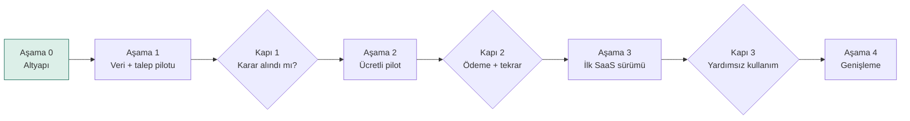
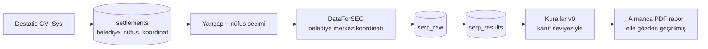

# Ortsrank – Yol Haritası

> Bölgesel hizmet veren işletmelerin Google görünürlüğünü, reklam harcamalarını ve gerçek şirket cirosunu birlikte değerlendirerek kanıtı gösterilen çalışma öncelikleri üretir.
> İşleten: TechNS UG (haftungsbeschränkt), Oberursel · Adres: https://ortsrank.foundercheck.de
> Son güncelleme: 21.10.2026 (sürüm 3.3)

---

## 1. İlk hedef

İlk hedef "SaaS hazır" değildir. İlk hedef şudur:

> **Bir müşteri, rapor sayesinde somut bir karar aldı ve devamı için ödeme yaptı.**

Otomasyona, hesap sistemine ve plan yönetimine yapılacak yatırım bu kanıttan sonra gelir. Mimari SaaS'a hazır kurulur (çok kiracılı şema, çok dilli altyapı); ekranlar ve özellikler ise talep geldikçe eklenir.

**Kapsam eki (3.3):** Reklam ve Ciro Analizi (WUA) modülü bölüm 12'de tanımlandı. Mevcut tarama pilotu sürer; yeni modül önce dosyadan ve TechNS incelemesiyle denenir. Otomatik bağlantılar sonraki teslimatlardır.

## 2. Müşteri ne satın alıyor?

Müşteri sıralama verisi değil, **öncelik** satın alır:

- Hangi çevre belediyelerde görünürüm, hangilerinde görünmüyorum?
- Hangi rakip hizmet bölgemin çoğunu kaplıyor?
- Önce hangi belediye ve hangi hizmet için çalışmalıyım?
- Reklam bütçemi ve içerik çalışmamı nereye yönlendirmeliyim?

Harita, sıralama ve rakip tablosu tek başına fark yaratmaz; BrightLocal ve Local Falcon bunları zaten coğrafi nokta bazında sunuyor. Ortsrank'ın farkı, Almanya'daki belirli hizmet sektörleri için **anlaşılır ve kanıtı gösterilen çalışma öncelikleri** üretmesidir.

| Sadece veri | Ortsrank'ın hedeflediği çıktı |
| --- | --- |
| "Hanau'da 12. sıradasınız." | "Hanau'da üç ticari aramada ilk 10 dışındasınız; ilk 10'daki iki yerel rakibin Hanau hizmet sayfası var ve bu aramalarda sıralanıyor (gözlem). Önce mevcut sayfanızın Hanau'daki hizmet ihtiyacını karşılayıp karşılamadığını inceleyin." |

## 3. Açık soru: raporu kim kullanıyor, işi kim yapıyor?

Bu soru ürünün kapsamını belirler ve pilotta cevaplanmalıdır.

| İlk müşteri tipi | Üründen beklediği temel değer | Ürün kapsamına etkisi |
| --- | --- | --- |
| İşletme sahibi | Sorunu anlamak, önceliği görmek, işi birine aktarabilmek | Sade dil, az teknik detay, devredilebilir görev listesi |
| Ajans / pazarlamacı | Analiz süresini azaltmak, müşteriye gerekçeli öneri sunmak, değişimi takip etmek | Detaylı veri, dışa aktarma, çoklu müşteri, white-label |
| TechNS'nin kendi ekibi | Danışmanlık ve uygulama hizmetini daha hızlı hazırlamak | Rapor + uygulama paketi; yazılım değil hizmet satışı |

**Çalışma hipotezi:** İlk pilot, tek bir sektörde, **işletme sahibi ile onun pazarlama işini yapan kişinin birlikte incelediği** raporlarla yapılır. Böylece "rapor anlaşılır mı?" ve "öneri uygulanabilir mi?" soruları aynı anda test edilir.

## 4. Değişmez ilkeler

| İlke | Anlamı |
| --- | --- |
| Gerçek veri | Ölçüm birimi, Destatis GV-ISys'teki **siyasi olarak bağımsız belediyelerdir** (Gemeinden, AGS anahtarı). Köy ve mahalleler ayrı birim değildir. Taranamayan belediye "taranamadı" olarak gösterilir, başka bir yerle doldurulmaz. |
| Temsilî ölçüm noktası | İlk sürümde her belediye **tek bir merkez koordinatından** ölçülür. Rapor bunun temsilî bir nokta olduğunu açıkça söyler. Büyük şehirlerde çok noktalı ölçüm daha sonra gelir. |
| İzlenebilirlik | Rapordaki her sayı ham sağlayıcı yanıtına, tarama zamanına, koordinata ve cihaza bağlıdır (`serp_raw`). |
| Kanıt seviyesi | Her bulgu *gözlem*, *çıkarım* veya *hipotez* olarak işaretlenir (bölüm 5). LLM sayı üretmez; yalnızca işaretlenmiş bulguları metne çevirir. |
| Doğruluk vaadi yok | Doğrulanmamış bir sapma sınırı ("±2 sıra" gibi) ürün vaadi olarak kullanılmaz. Ölçüm sınırları raporda açıkça yazılır. |
| Nedensellik iddiası yok | "Sayfa yayınlandı → sıra yükseldi" etki kanıtı değildir. Ürün yalnızca yapılan işlemi ve sonrasındaki değişimi birlikte gösterir. |
| Müşteri ayrımı | Her müşteri verisi `organization_id` taşır. İlk dış kullanıcı erişiminden önce, zorunlu kiracı filtreli sorgu katmanı ve izolasyon testi hazırdır. Postgres RLS, ilk SaaS sürümünde ek savunma katmanı olarak eklenir. |
| Çok dillilik | Altyapı DE/EN/TR. Pilot arayüzü ve raporu Almanca. Arama dili her zaman Almanca. |
| Kullanım kolaylığı | Hedef kullanıcı teknik bilgisi olmayan bir işletme sahibidir. Her ekran tek bir ana soruya cevap verir; ana bilgiye en fazla üç tıklamayla ulaşılır. Dil sade, terimler açıklanır; boş, hata ve yükleme durumları ne olduğunu ve ne yapılacağını söyler. Mobilde okunur, klavyeyle kullanılır (WCAG 2.1 AA). Bir özellik kullanımı zorlaştırıyorsa eklenmez veya sadeleştirilir. |
| Tek yerden yönetim | Birden fazla sayfada geçen her şey tek bir kaynaktan gelir ve tek yerden değiştirilir: arayüz metinleri, hukuk metinleri, keyword setleri, rakip etiketleri, plan ve kota limitleri, fiyatlar, durum etiketleri, e-posta şablonları. Aynı bilgi iki yerde elle tutulmaz; bir değişiklik bütün sayfalara yansır. Operasyonel olarak değişmesi gerekenler admin panelinden düzenlenir. |
| Admin paneli | TechNS için iç yönetim paneli. Yalnızca platform yöneticisi rolüyle erişilir (müşteri organizasyon rollerinden ayrı), 2FA zorunlu; müşteri verisine her erişim audit log'a yazılır. Aşamalı kurulur (bölüm 7). |

## 5. Kanıt seviyeleri

| Seviye | Tanım | Örnek | Raporda nasıl görünür |
| --- | --- | --- | --- |
| Gözlem | Bir veri kaynağında (SERP, sayfa taraması, GBP) doğrudan doğrulanmış olgu. Kaynak ve kapsam (tarih, nokta, cihaz, örneklem) belirtilir. Hangi kaynaktan geldiği seviyeyi değiştirmez. | "Rakibin Hanau hizmet sayfası var ve incelenen sorguda sıralanıyor." · "20.10.2026'da Hanau merkez noktasından, mobil, 3 örneklemede bu keyword için reklam görülmedi." | Doğrudan ifade + kaynak bağlantısı |
| Çıkarım | Gözlemlerin değerlendirilmesi; bir yorum içerir. Dayandığı gözlemler gösterilir. | "Sayfa içeriği, bu sorgunun hizmet ve konum niyetiyle uyumlu görünüyor." | İfade + dayandığı gözlemler |
| Hipotez | Henüz sınanmamış bir neden veya etki varsayımı. | "Benzer ihtiyacı karşılayan bir sayfa hazırlamak görünürlüğümüzü artırabilir." | "Doğrulanmalı" etiketiyle |

"Sizde yok" gibi bir ifade, ancak müşterinin kendi sitesi de aynı yöntemle kontrol edildiyse gözlemdir.

**Veriden çıkarılabilecek sonuçların sınırı**

| Toplanan veri | Destekleyebileceği sonuç | Tek başına desteklemediği sonuç |
| --- | --- | --- |
| Üç taramada reklam görülmemesi | Bu örneklerde reklam gözlenmedi | Bölgede reklam rekabeti yok |
| Rakibin ilk üçte olması | Rakip bu sorguda görünür | Rakibin SEO'su kolayca geçilebilir |
| Şehir sayfasının sonuçlarda görünmesi | Sayfa ilgili sorguda sıralanıyor | Başarının nedeni şehir sayfası |
| İşletmenin ilk 20'de bulunmaması | Taranan ilk 20 sonuçta bulunamadı | Google'da hiç görünmüyor |

**Aksiyon türleri**

| Tür | Dayandığı bulgu | Örnek |
| --- | --- | --- |
| İnceleme | Gözlem | "Önce mevcut sayfanızın Hanau'daki hizmet ihtiyacını karşılayıp karşılamadığını inceleyin." |
| İyileştirme | Gözlem + çıkarım, inceleme sonucuyla birlikte | "Ayrı ve yararlı içerik ihtiyacı doğrulandıysa mevcut sayfayı geliştirin veya yeni sayfa planlayın." |
| Doğrulama çalışması | Hipotez | "Küçük bütçeli test kampanyasıyla bu keyword'deki reklam maliyetini ölçün; sonucu kaydedin." |

Bir rakipte bir sayfanın bulunması, tek başına yeni sayfa açmayı gerekçelendirmez. Öneriler önce incelemeyle başlar; iyileştirme, ihtiyaç doğrulandıktan sonra gelir.

Hipotezi sınamak da değerli bir aksiyondur; ancak doğrulanmış bulguya dayalı iyileştirmeyle karıştırılmaz.

## 6. Ölçüm ölçütleri

İki ayrı şey ölçülür ve ayrı kabul ölçütleriyle değerlendirilir.

| Alan | Ne ölçülür | Kabul ölçütü (ilk sürüm) |
| --- | --- | --- |
| Sistem doğruluğu | Kayıt bütünlüğü | Görevlerin %100'ü başarı, hata veya iptal durumuyla kayıtlı |
| | Geçerli sonuç oranı | Tanımlanan tekrar denemelerinden sonra görevlerin en az %98'i kullanılabilir sonuç üretmiş |
| | Gönderilen parametre = kaydedilen parametre (koordinat, keyword, cihaz, dil) | %100, otomatik testle |
| | Ayrıştırma doğruluğu: ham yanıt ↔ ayrıştırılmış sonuç | 50 rastgele yanıtta elle kontrol, hata yok |
| Sonuç değişkenliği | Aynı sorgu, aynı nokta, farklı zamanlarda (ör. 3 gün) | İlk 10 örtüşmesi ve sıra farkı raporlanır; eşik değil, ölçülen değer olarak |
| | Reklam görülme sıklığı | Örneklem sayısıyla birlikte yüzde olarak verilir |

Değişkenlik ölçümünün sonucu, rapordaki ölçüm sınırı metnine olduğu gibi yazılır. Ürün vaadine dönüştürülmez.

**Dönem karşılaştırma şartları**

Dönem karşılaştırmaları aynı keyword, koordinat, cihaz, dil ve tarama derinliği üzerinden yapılır. Örnekleme saatleri mümkün olduğunca eşleştirilir. Ayar değişiklikleri işaretlenir; başarısız ölçümler sıralama kaybı sayılmaz.

## 7. Aşamalar

| Aşama | Kapsam | Geçiş ölçütü | Tahmini süre |
| --- | --- | --- | --- |
| 0. Altyapı | Domain, Vercel, repo, iskelet, şema | – | Tamamlanıyor |
| 1. Veri + talep pilotu | Script ile tarama; 1 sektör; 20–30 belediye, 3–5 keyword; 3–5 işletmeye Almanca rapor | Ölçüm ölçütleri karşılandı; pilot kayıtlarında en az 2 işletme rapor nedeniyle önceliğini değiştirdi | Teknik: 2–3 hafta · Müşteri bulma ve görüşmeler: 3–4 hafta (paralel) |
| 2. Ücretli pilot | Salt-okunur web raporu; kanıt seviyeli öneriler; ikinci tarama ve karşılaştırma | Gerçek ödeme alındı; en az 2 müşteri **ücretli** ikinci ölçüm aldı | 4–6 hafta |
| 3. İlk SaaS sürümü | Hesap, organizasyon, ödeme, kota, planlı yeniden tarama, tam hukuk metinleri | Müşteri temel akışı yardımsız tamamlıyor; ilk abonelik yenilemesi | 6–8 hafta |
| 4. Genişleme | Ajans özellikleri, white-label, ek sektörler, çok noktalı ölçüm, API, AT/CH | Mevcut müşterilerden doğrulanmış talep | sürekli |

Bu süreler mevcut bölgesel tarama kapsamı içindir; WUA modülünün ek eforu veri pilotundan sonra ayrı tahmin edilir.

Süreler akşam/hafta sonu temposuna göredir. Veri üretimi ile müşteri bulma, görüşme ve geri bildirim ayrı planlanır; ikincisi genellikle daha uzun sürer.

---

### Aşama 0 – Altyapı

- [x] Subdomain `ortsrank.foundercheck.de` (KAS DNS'te CNAME → `cname.vercel-dns.com`)
- [x] Vercel projesi `ortsrank` (Next.js, bölge `fra1`)
- [x] GitHub reposu `technsug-ops/-ortsrank`
- [x] İskelet: Next.js 16, React 19, Tailwind v4, TypeScript; çok dilli yönlendirme (`/de`, `/en`, `/tr`)
- [x] Çok kiracılı şema; kimlik tabloları Better Auth yapısında; `serp_raw` ve `scan_mode`
- [x] Fontlar self-host (Google Fonts'a istek yok)
- [ ] Vercel ↔ GitHub bağlantısı ve ilk production deploy
- [ ] Neon Postgres (Frankfurt), migration uygulaması
- [ ] Repo adını `ortsrank` olarak düzeltmek (isteğe bağlı)

---

### Aşama 1 – Veri + talep pilotu

**Hedef:** Gerçek verilerle, yarı manuel olarak 3–5 işletmeye rapor hazırlamak. Bu hem ölçümü hem müşterinin ilgisini sınar. Web arayüzü yok; tarama ve rapor script ile üretilir.

**Veri**

- [ ] Destatis GV-ISys import scripti: AGS, belediye adı, Bundesland, Kreis, nüfus, nüfus tarihi, koordinat
- [ ] `location_coordinate` testi: 10 belediyede koordinat sorgusu ile şehir kodu sorgusunun karşılaştırılması
  - [ ] Not: DataForSEO'daki bu yarıçap, ölçüm noktasının hassasiyetidir. Hizmet alanı yarıçapıyla (km) ilgisi yoktur; kodda ayrı adlandırılır.
- [ ] Koordinatla sorgulanamayan belediye için yedek yöntem veya `scan_mode = none`
- [ ] Tarama scripti: proje tanımı (domain, merkez, yarıçap, nüfus eşiği, keywordler) → `serp_raw` + `serp_results`
- [ ] Reklam örneklemesi: ana keyword için 3 tekrar, farklı saatlerde
- [ ] Sayfa taraması (sınırlı): ilk 10'daki yerel rakiplerin ve **müşterinin kendi sitesinin** ilgili sayfaları; "var/yok" ancak her iki taraf aynı yöntemle kontrol edildiyse gözlemdir
- [ ] Kurallar v0 (5 kural), her bulgu kanıt seviyesiyle
- [ ] Ölçüm ölçütleri (bölüm 6) için otomatik testler ve değişkenlik ölçümü
- [ ] Rapor şablonu (Almanca PDF): durum, rakipler, kanıt seviyeli öneriler, ölçüm sınırları bölümü
- [ ] Gerçek maliyet kaydı: SERP, tekrar denemeler, kontrol sorguları, sayfa taraması, LLM, depolama

**Talep**

- [ ] Sektör seçimi: Terrassenüberdachung (alternatif: Arbeitsbühnen Vermietung)
- [ ] 3–5 pilot işletme; tercihen her birinde işletme sahibi + pazarlamacısı birlikte
- [ ] Pilot anlaşması (kısa): ücretsiz/ücretli, veri kullanımı, gizlilik (bkz. Aşama 2 hukuk)
- [ ] Rapor teslimi ve açıklama görüşmesi

**Her pilot için kayıt (zorunlu)**

| # | Soru | Kayıt biçimi |
| --- | --- | --- |
| 1 | Müşteri rapordan hangi yeni bilgiyi öğrendi? | Müşterinin kendi cümlesiyle |
| 2 | Bu bilgi nedeniyle hangi önceliğini değiştirdi? | Somut karar veya "değişmedi" |
| 3 | Yapılacak işi kim üstlendi? | İşletme sahibi / mevcut ajans / TechNS / kimse |
| 4 | İkinci ölçüm için ödeme yaptı mı? | Ücretsiz tekrar istedi / ücretli ikinci ölçüm aldı / hayır |
| 5 | Raporu hazırlamak ve açıklamak toplam kaç saat sürdü? | Saat; hazırlık ve açıklama ayrı |

5. madde fiyatlandırmayı belirler: API maliyeti düşük olsa bile her müşteriye iki saat açıklama gerekiyorsa, ürün ve fiyat modeli buna göre kurulur.

**Kapı 1:** Ölçüm ölçütleri karşılandı ve pilot kayıtlarında en az 2 işletme rapor nedeniyle önceliğini değiştirdi (madde 2).

---

### Aşama 2 – Ücretli pilot

**Hedef:** Gerçek ödeme ve tekrar kullanım kanıtı.

- [ ] Ayrı iş paketi olarak WUA-1 dosyadan reklam/ciro analizi pilotu (bölüm 12); modül bazında ödeme ve emek kaydı.

**İlk dış erişimden önce zorunlu**

- [ ] Erişim kontrolü: müşteri yalnızca kendi raporunu görür (imzalı, süreli link veya basit giriş)
- [ ] Zorunlu kiracı filtreli sorgu katmanı + izolasyon testi
- [ ] Pilot sözleşmesi: kapsam, fiyat, süre, veri kullanımı, sorumluluk sınırı
- [ ] Datenschutzerklärung (pilot sürümü): alt işleyenler (Vercel, Neon, DataForSEO, Anthropic), AB dışı aktarım dayanağı (DPF veya SCC)
- [ ] AVV (müşteri adına veri işleniyorsa, ör. ajans müşterileri)
- [ ] Faturalama: E-Rechnung uyumlu fatura (lexoffice veya sevDesk); bu aşamada Stripe şart değil
- [ ] Impressum

**Ürün**

- [ ] Salt-okunur web raporu (Almanca): harita, belediye tablosu, rakip özeti
- [ ] Kullanılabilirlik testi: en az 2 pilot işletme sahibi raporu yardımsız açıp ana bulguyu kendi cümlesiyle söyleyebiliyor
- [ ] Belediye detayı ve rakip özeti; her öneride kanıt seviyesi ve kaynak
- [ ] Planlı ikinci tarama ve önceki ölçümle karşılaştırma, dönem karşılaştırma şartlarına göre (bölüm 6)
- [ ] Değişim gösterimi: "işlem + sonrasındaki değişim", nedensellik iddiası olmadan
- [ ] Fiyat testi: tek rapor ve ikinci ölçüm için en az iki fiyat noktası

**Admin paneli v1 (iç kullanım)**

- [ ] Platform yöneticisi rolü ve girişi (2FA), müşteri rollerinden ayrı
- [ ] Müşteri ve proje listesi; proje başına merkez, yarıçap, keywordler
- [ ] Taramalar: durum, oturumlar, bütçe defteri (confirmed / uncertain / kalan), maliyet
- [ ] Rapor yayınlama ve müşteri erişim linkleri (oluştur, süre ver, iptal et)
- [ ] Pilot kayıtları (5 soru) ve açıklama süresi girişi
- [ ] Keyword setleri ve rakip etiket listesi: tek yerden düzenleme
- [ ] Müşteri verisine her erişim audit log'da

**Ayrı kaydedilecek sinyaller**

| Sinyal | Gücü |
| --- | --- |
| Ücretsiz tekrar isteği | Zayıf: ilgi var |
| Ücretli ikinci ölçüm | Orta: değer görüyor |
| Abonelik yenilemesi | Güçlü: düzenli kullanım |

**Kapı 2:** Gerçek ödeme alındı ve en az 2 müşteri **ücretli** ikinci ölçüm aldı.

---

### Aşama 3 – İlk SaaS sürümü

**Hedef:** Müşteri temel akışı yardımsız tamamlıyor.

- [ ] WUA talebi doğrulanırsa dosya yükleme, veri kalitesi ve yönetici raporu akışı; otomatik bağlantılar ayrı fizibilite ve teslimatla (bölüm 12).

- [ ] Better Auth: e-posta doğrulamalı giriş, organizasyon, davet; roller pilot bulgularına göre (başlangıçta owner + member)
- [ ] Postgres RLS (ek savunma katmanı)
- [ ] Proje oluşturma akışı: domain → sektör → merkez → yarıçap → nüfus → keywordler
- [ ] Planlı yeniden tarama (aylık) ve trend görünümü
- [ ] Planlar ve kota: plan sayısı ve sınırları Aşama 2 fiyat testine göre; maliyet tavanı
- [ ] Stripe Billing, Customer Portal, webhook ile plan senkronu
- [ ] Tam hukuk metinleri: AGB, Widerrufsbelehrung (B2C ihtimali), veri saklama politikası (ham SERP 12 ay)
- [ ] Ücretsiz deneme varsa kötüye kullanım koruması: e-posta doğrulaması, hız sınırı, günlük bütçe tavanı, bot koruması
- [ ] E-postalar (Almanca; EN/TR talep varsa): rapor hazır, değişim özeti, kota uyarısı
- [ ] Gözlem: Sentry, çerezsiz analitik (Plausible), tarama hata oranı alarmı
- [ ] Hesap silme ve veri dışa aktarma (DSGVO Art. 17 ve 20)

**Admin paneli v2**

- [ ] Kullanıcı ve organizasyon yönetimi (davet, rol, devre dışı bırakma)
- [ ] Planlar, kota ve fiyatlar: tek yerden düzenleme, değişiklik geçmişiyle
- [ ] Ödeme durumu (Stripe), başarısız ödemeler
- [ ] Sistem sağlığı: tarama hata oranı, sağlayıcı maliyeti, kuyruk durumu
- [ ] İçerik yönetimi: e-posta şablonları ve hukuk metinleri (sürümlü)
- [ ] Audit log görüntüleme ve dışa aktarma

**Kapı 3:** Müşteriler temel akışı yardımsız tamamlıyor ve ilk abonelik yenilemesi gerçekleşti.

---

### Aşama 4 – Genişleme

Yalnızca mevcut müşterilerden doğrulanmış talep varsa:

- [ ] Ajans çalışma alanları, çoklu müşteri, white-label PDF
- [ ] Çok noktalı ölçüm (büyük şehirler için belediye içinde birden fazla nokta)
- [ ] Ek sektör keyword setleri
- [ ] Arayüz ve rapor için EN/TR
- [ ] REST API
- [ ] Avusturya ve İsviçre (Statistik Austria, BFS)
- [ ] AI arama görünürlüğü – ayrı modül olarak değerlendirme
- [ ] Sektör × belediye veri sayfaları – yalnızca kendine özgü gerçek veri taşıyorsa ve sınırlı sayıda

---

## 8. Tüm aşamalar boyunca

| Konu | Uygulama |
| --- | --- |
| Maliyet | Her tarama ve rapor için SERP, tekrar denemeler, kontrol sorguları, sayfa taraması, LLM, depolama ve **açıklama süresi** kaydedilir |
| Test | Vitest (kurallar, hesaplar, izolasyon), ölçüm ölçütü testleri; Playwright e2e Aşama 3'ten itibaren |
| Güvenlik | Gizli anahtarlar Vercel env'de; hız sınırı; bağımlılık taraması |
| Yedek | Neon point-in-time recovery; migration'lar repoda |
| Sahiplik | Kod, marka ve domain TechNS UG adına; ortak girerse IP devri yazılı |

## 9. Teknik yığın

| Katman | Seçim | Ne zaman |
| --- | --- | --- |
| Uygulama | Next.js 16, React 19, TypeScript | Aşama 0 |
| Arayüz | Tailwind CSS v4, MapLibre GL | Aşama 2 |
| i18n | `src/app/[lang]` + `proxy.ts` + JSON sözlükler | Aşama 0 |
| Veritabanı | Neon Postgres (Frankfurt), Drizzle ORM | Aşama 1 |
| SERP verisi | DataForSEO, belediye merkez koordinatıyla | Aşama 1 |
| Analiz metni | Claude API, structured output, yalnızca işaretli bulgulardan | Aşama 1 |
| PDF | Playwright | Aşama 1 |
| Kuyruk | Script (Aşama 1), Inngest (Aşama 3) | Aşama 3 |
| Kimlik | Better Auth | Aşama 3 |
| Ödeme | Fatura programı (Aşama 2), Stripe Billing (Aşama 3) | Aşama 2–3 |
| E-posta | Resend + React Email | Aşama 3 |
| Gözlem | Sentry, Plausible | Aşama 3 |

## 10. Açık kararlar

| Karar | Ne zaman gerekli |
| --- | --- |
| Pilot sektörü ve ilk 3–5 işletme | Aşama 1 başı |
| İlk müşteri tipi (sahip / ajans / TechNS hizmeti) | Aşama 1 sonu, pilot kayıtlarına göre |
| DataForSEO hesabı ve aylık bütçe limiti | Aşama 1 başı |
| Pilot fiyatı (tek rapor, ikinci ölçüm) | Aşama 2 başı |
| Plan yapısı ve abonelik fiyatı | Aşama 3 başı, fiyat testine göre |
| Ortsrank marka tescili (DPMA) | Aşama 3 öncesi |
| Ayrı domain (ortsrank.de) | Aşama 4 |

## 11. Değişiklik geçmişi

| Tarih | Sürüm | Değişiklik |
| --- | --- | --- |
| 20.10.2026 | 1 | İlk sürüm (9 teknik faz) |
| 20.10.2026 | 2 | Bağımlılıklar düzeltildi; koordinatla sorgu; `serp_raw`; Better Auth hizası; SCC/DPF; kötüye kullanım koruması |
| 20.10.2026 | 3 | Dış değerlendirmeye göre yeniden yapılandırıldı: ilk hedef "ödeme + somut karar"; 4 aşama; veri ve talep pilotu birleşti; kanıt seviyeleri ve aksiyon türleri; ölçüm ölçütleri (sistem doğruluğu ≠ değişkenlik); "±2 sıra" vaadi kaldırıldı; "her yerleşim" yerine "belediyeler" ve temsilî ölçüm noktası; tekrar ölçüm ilk ücretli sürüme alındı; erişim kontrolü ve pilot hukuku ilk dış erişimden önceye bağlandı; pilot kayıtları ve açıklama süresi; sinyaller ayrı kaydediliyor |
| 21.10.2026 | 3.1 | Başarı ölçütü ikiye ayrıldı (kayıt bütünlüğü, geçerli sonuç oranı); kanıt seviyesi tanımları düzeltildi (kaynak türü seviyeyi belirlemez); "rakipte var, sizde yok → sayfa açın" yerine önce inceleme; müşterinin kendi sitesi de kontrol edilir; dönem karşılaştırma şartları eklendi |
| 21.10.2026 | 3.2 | İlkelere eklendi: kullanım kolaylığı, tek yerden yönetim, admin paneli; admin paneli v1 (Aşama 2) ve v2 (Aşama 3) görevleri; Aşama 2'ye kullanılabilirlik testi |
| 21.10.2026 | 3.3 | Reklam ve Ciro Analizi (WUA) modülü eklendi (bölüm 12): dosyadan pilot, gerçek ciro ile Ads atfının ayrımı, veri kalite kuralları, yönetici raporu, aşamalı bağlantılar; tarama pilotu kapsamı ve 3.2 ilkeleri korundu. Müşteri veri belgesi: `docs/Datenbedarf_Werbe_Umsatzanalyse.md` (1.1) |

## 12. Reklam ve Ciro Analizi modülü (WUA)

### Amaç ve mevcut kapsamla ilişkisi

Ortsrank iki analiz alanını birlikte sunar:

1. **Bölgesel görünürlük:** Hangi belediyede, hangi sorguda ve hangi rakibe karşı görünürlük var?
2. **Reklam ve iş sonuçları:** Harcama, gerçek şirket cirosu, talepler ve işletme kararları zaman içinde nasıl değişti; hangi inceleme veya aksiyon öncelikli?

İkinci alan, 21.10.2026 tarihli “Datenbedarf – Werbe- und Umsatzanalyse” belgesinden eklenmiştir. Bu bir ürün kapsamı kararıdır; entegrasyonların veya hesaplamaların uygulanmış olduğu anlamına gelmez. İlgili müşteri veri ihtiyaç belgesi Almancadır.

Mevcut `PHASE1_PLAN.md` teknik teslimatı (belediye importu, tarama, bütçe, deneme kayıtları, dry-run) kendi kapsamıyla tamamlanır. WUA ayrı iş paketidir; mevcut tarama scriptlerine Ads bağlantısı veya ciro importu eklemek ilk teslimatın koşulu değildir. Veri toplama görüşmeleri paralel başlayabilir. Yeni modülün eforu mevcut süre tahminlerine dahil değildir.

### Kapsam ve aşamalar

| Paket | Zamanlama | Teslimat | Kabul ölçütü |
| --- | --- | --- | --- |
| WUA-0: Veri sözleşmesi | Aşama 1 boyunca, tarama geliştirmesinden bağımsız | Aylık veri alanları, kaynak/kapsam tanımları, görüşme formu ve kalite kuralları | Net/brüt, para birimi, tarih temeli, dönem ve kanal kapsamı belirli; gerçek müşteri verisi kullanılmadan önce erişim ve işleme koşulları belirlenmiş |
| WUA-1: Dosyadan analiz pilotu | İlk tarama teslimatından sonra; Aşama 2 içinde | Ads dışa aktarımı + aylık ciro + faaliyet takvimi; TechNS tarafından kontrol edilen Almanca yönetici raporu | Kaynak toplamları uzlaştırıldı; eksikler ve kısmi aylar işaretli; metrikler yeniden hesaplanabilir; müşteri kararı ve toplam emek kaydedildi |
| WUA-2: Tekrarlanabilir ürün akışı | Aşama 3; WUA-1 talebi doğrulanırsa | Dosya yükleme, eşleme önizlemesi, sürümleme, dönem karşılaştırması, inceleme/onay akışı | Müşteri veri yükleyebiliyor; tekrar yükleme çift saymıyor; organizasyon izolasyonu ve rapor kaynak izi testli |
| WUA-3: Otomatik bağlantılar | Aşama 3–4; kullanım ve fizibiliteye göre | Önce Google Ads; sonra gerekliyse GA4, Search Console ve Unternehmensprofil | Her bağlantı için erişim, hesap kimliği, geçmiş veri kapsamı, yenileme/hata/iptal akışı ayrı doğrulanmış |

Pilot bağlantı erişimine bağımlı değildir; CSV/XLSX dışa aktarımlarıyla başlayabilir. “Bağlandıktan sonra her şey otomatik” veya sabit kurulum süresi vaat edilmez. API izinleri, tarihsel veri kapsamı ve erişim düzeyleri uygulama sırasında resmi dokümanlarla doğrulanır.

### Başlangıç veri sözleşmesi

Hedef 24–36 aylık geçmiş veridir. Daha kısa geçmiş kabul edilir; 12 ay öncesi eşleşme yoksa yıllık karşılaştırma yapılmaz, mevsimsellik iddiaları sınırlandırılır. Ads dönüşüm verisi yoksa ciro/harcama karşılaştırması yapılabilir; lead maliyeti ve dönüşüm verimliliği hesaplanamaz.

| Veri grubu | Gerekli alanlar / ilk pilot yaklaşımı |
| --- | --- |
| Şirket cirosu | Ay, tutar, para birimi, net/brüt, sipariş/fatura/montaj gibi tarih temeli, iptal/iade işleme biçimi, veri kesim tarihi, tam/kısmi ay, kaynak |
| Reklam harcaması | Ay, kanal, hesap kimliği, maliyet ve maliyet kapsamı; mevcutsa kampanya, gösterim, tıklama; ajans/üretim ücretleri medya bütçesinden ayrı |
| Dönüşümler | Mevcutsa dönüşüm eylemi, tanımı, sayısı, değerin gerçek satış/atanmış lead değeri oluşu, sayım ve atıf ayarları, takip değişiklikleri; eksikliği açıkça gösterilir |
| Satış süreci | Mevcutsa aylık talep, teklif, kazanılmış sipariş, ortalama sipariş tutarı, iptal; tanımlar ve kayıt tarihleri |
| İş bağlamı | Hedef, ürün/hizmet, hizmet alanı, bütçe kararları, kampanya/indirim tarihleri, fiyat ve kapasite değişiklikleri; ilk görüşmede kaydedilebilir |
| Ek kırılımlar | Mevcutsa ürün grubu, satış kanalı ve toplulaştırılmış bölge; kişisel müşteri isim/adresleri alınmaz |
| Karlılık | Yalnızca müşteri kârlılık analizi istiyorsa ürün maliyeti, katkı payı veya uygun maliyet verisi; yoksa kâr/ROI iddiası yok |

Firma, yıl/ay, kaynak, ölçü birimi ve para birimi her veri setinde açık olmalıdır. “Bin EUR” tutarı EUR'ya yalnızca doğrulanmış birim bilgisiyle dönüştürülür; dönüşüm kayda alınır. Bölge cirosu yoksa firma toplamı belediyelere tahminen dağıtılmaz.

### Metrikler ve yorum sınırları

| Metrik | Hesap | İzin verilen yorum |
| --- | --- | --- |
| Google Ads harcamasının ciroya oranı | Ads medya harcaması / gerçek şirket net cirosu × 100 | Aynı dönem şirket düzeyinde oran; toplam pazarlama maliyeti değildir |
| Toplam reklam harcamasının ciroya oranı | Kapsama alınan tüm medya harcamaları / gerçek şirket net cirosu × 100 | Yalnızca kanalların kapsama durumu açıkça belirtilerek |
| Ads harcaması başına şirket cirosu | Gerçek şirket net cirosu / Google Ads medya harcaması | Şirket düzeyinde betimleyici oran; Ads ROAS veya reklamın yarattığı gelir değildir |
| Toplam medya harcaması başına şirket cirosu | Gerçek şirket net cirosu / tüm medya harcamaları | Toplu verimlilik oranı; eksik kanal varsa kısmi kapsam etiketli |
| Google Ads raporlanan ROAS | Ads'e atfedilmiş dönüşüm değeri / Ads maliyeti | Ayrı metrik; değerin satış mı atanmış lead değeri mi olduğu belirtilir. Şirket cirosunun yerine kullanılmaz |
| CPC / CTR / CPL | Maliyet/tıklama; tıklama/gösterim; maliyet/tanımlı lead | Pay ve payda aynı kapsamda; CPL yalnızca lead tanımı ve sayımı doğrulanmışsa |
| Aylık/yıllık değişim | Karşılaştırılabilir döneme göre yüzde ve mutlak değişim | Kısmi ay tam ayla eşitmiş gibi karşılaştırılmaz; sıfır bazda yüzde yerine açıklama |

Payda sıfırsa “hesaplanamaz”; eksik veri sıfır sayılmaz. Net ve brüt tutarlar karıştırılmaz. Ajans ve içerik maliyeti dahil bir toplam pazarlama oranı ayrıca istenirse maliyet kapsamı ayrı tanımlanır.

**Nedensellik:** Toplam ciro ile harcamanın birlikte değişmesi reklamın etkisini tek başına kanıtlamaz. Satış gecikmesi, kapasite, fiyat, sezon, organik trafik, tavsiyeler ve diğer kanallar alternatif açıklamalar olarak ele alınır. Gecikmeli karşılaştırmalar keşif amaçlıdır. Günlük veri yoksa ayın ilk 20 günü önceki yılın ilk 20 günüyle karşılaştırılmış gibi sunulmaz.

**Satış hunisi:** Aynı ayın talep, teklif ve sipariş toplamları farklı müşterilere ait olabilir. Kohort/eşleşme yoksa kesin tekliften satışa dönüşüm oranı üretilmez. Platform dönüşüm sayıları ile işletmenin talepleri/satışları uzlaştırılır; birbirine eklenmez.

**Coğrafi bağlantı:** SERP'te bir belediyede zayıf görünürlük ile şirket toplam cirosu aynı raporda gösterilebilir. Belediye düzeyinde satış/lead verisi olmadan “bu şehir şu kadar ciro kaybettirdi” sonucu üretilmez. Google Ads konum kırılımlarının anlamı ayrıca doğrulanır; belediye anahtarına zorla eşlenmez.

### Veri kalitesi ve teknik kabul

- [ ] İçe aktarma öncesi alan ve birim eşleme önizlemesi; kaynak dosyası ve import sürümü korunur.
- [ ] Eksik ay, tekrar kayıt, kısmi ay, para birimi ve tarih temeli uyumsuzlukları raporlanır; sessizce doldurulmaz.
- [ ] Kaynak toplamlarıyla aylık/yıllık toplamlar uzlaştırılır; hatalı veya yinelenen import çift sayılmaz.
- [ ] Sıfır payda, eksik ay, iade/storno, kısmi ay, binlik birim ve aynı dosyanın tekrar yüklenmesi için anlamlı testler.
- [ ] Müşteriye özel gelir/harcama tabloları organizasyona bağlıdır; rapor, dosya erişimi ve dışa aktarmada izolasyon testlidir.
- [ ] Hesaplamalar deterministik kodla yapılır. LLM yalnızca doğrulanmış metrikleri ve kanıt seviyeli bulguları anlatır; sayı veya nedensellik eklemez.
- [ ] Gerçekleşmiş olaylar ile müşterinin yorumu ayrılır; her öneri kaynak, gerekçe, sorumlu ve sonraki kontrol tarihi taşır.
- [ ] Pilot raporu insan kontrolünden geçmeden müşteriye yayımlanmaz.
- [ ] Müşteri verilerinin saklama/silme, erişim ve hizmet sağlayıcı kapsamı gerçek akışa göre belirlenir. Ham SERP için seçilen süre gelir dosyalarına otomatik uygulanmaz.

Önerilen yeni veri alanları: `imports`, `monthly_revenue`, `monthly_ad_metrics`, `business_events`, `business_goals`, `sales_funnel_metrics`, `analysis_reports`. Bunlar tasarım önerisidir; mevcut şemayla karşılaştırılmadan ikinci kullanıcı/organizasyon yapısı oluşturulmaz.

### Yönetici raporu ve iş modeli

Raporda önce kısa yönetici özeti, sonra gerçek ciro ve reklam harcaması trendi, kapsamı açık oranlar, veri varsa satış süreci, faaliyet/karar zaman çizgisi, bölgesel görünürlük ve en fazla 3–5 öncelikli aksiyon bulunur. Her aksiyon gözlem/çıkarım/hipotez seviyesini ve eksik veriyi gösterir.

İlk ticari test: “Yerel Görünürlük”, “Reklam ve Ciro Analizi” ve “Birleşik Yönetici Raporu” için müşterinin hangi çıktıya ödeme yaptığı ayrı kaydedilir. Bunlar henüz fiyatlandırılmış planlar değildir. TechNS danışmanlığına verilen ödeme, otomatik yazılım talebinin tek başına kanıtı sayılmaz. Görüşme ve rapor hazırlama süresi maliyete dahil edilir.

**WUA pilot kapısı:** En az bir rapor gerçek verilerle kaynak toplamlarına uzlaştırılmış ve müşteriyle incelenmiş olmalı; hangi kararın alındığı kaydedilmelidir. WUA'yı otomatikleştirmek için modülün kendisine ödeme veya ücretli tekrar talebi ayrıca gösterilmelidir. Bölgesel tarama için mevcut Kapı 1–3 koşulları korunur.

### Kaynak ve uygulama notları

- Kullanıcı belgesi: “Datenbedarf – Werbe- und Umsatzanalyse”, 21.10.2026; bu sürümle pilot diline uyarlanmıştır.
- Google Ads dönüşüm değerleri sabit veya işleme özgü atanabilir; kontrol: https://support.google.com/google-ads/answer/7197048
- Google Ads erişim düzeyleri ayrı doğrulanmalı: https://support.google.com/google-ads/answer/9978556
- Search Console geçmiş kapsamı Ads/ciro ile aynı varsayılmaz; mevcut geçmiş ve önceki dışa aktarımlar ayrı kaydedilir: https://developers.google.com/search/docs/monitor-debug/debugging-search-traffic-drops

---

## İlgili belgeler

- Proje dokümanı (senaryolar, rakip analizleri): https://claude.ai/code/artifact/f682b20a-5ad9-4b55-9f46-ec5a13133c32
- Müşteri veri ihtiyaç belgesi: [`Datenbedarf_Werbe_Umsatzanalyse.md`](Datenbedarf_Werbe_Umsatzanalyse.md) (21.10.2026, sürüm 1.1)
- Teknik tarama planı: `PHASE1_PLAN.md`; WUA ilk teknik teslimata dahil değildir.
- Veri modeli: `src/db/schema.ts`
- Kurulum: `README.md`
