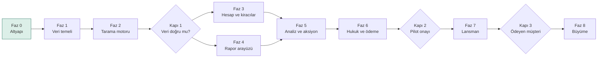
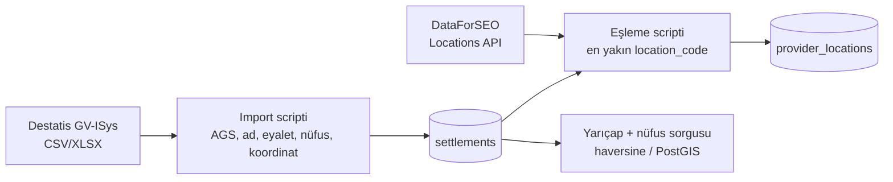
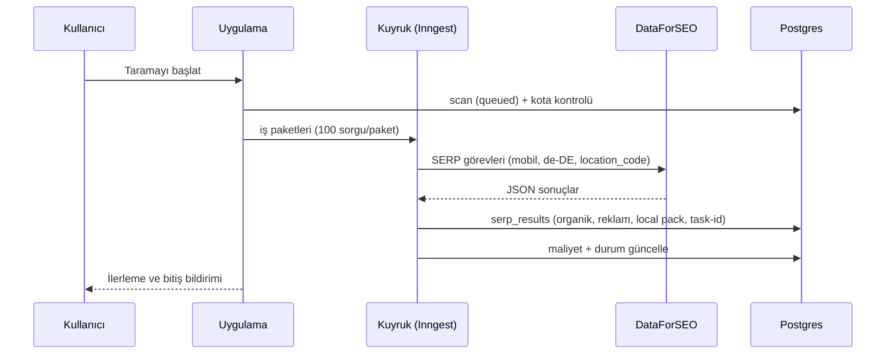
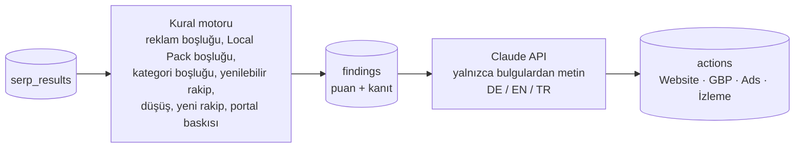

# Ortsrank – Yol Haritası

> Lokal Google görünürlüğü, yerleşim yerleşim: sıralama, reklam verenler, rakipler ve somut aksiyonlar.
> İşleten: TechNS UG (haftungsbeschränkt), Oberursel · Adres: https://ortsrank.foundercheck.de
> Son güncelleme: 20.10.2026

---

## 1. Ürün tek cümlede

Bir işletme domainini, sektörünü ve hizmet alanını girer; Ortsrank bu alandaki **her gerçek yerleşimde** (Destatis Gemeindeverzeichnis) Google'ı tarar. Organik sırayı, reklam verenleri ve Local Pack'i ayrı ayrı ölçer, bir rakip matrisi çıkarır ve her şehir ile her rakip için **öncelikli aksiyon listesi** üretir.

## 2. Değişmez ilkeler

| İlke | Anlamı | Nerede uygulanır |
| --- | --- | --- |
| Gerçek veri | Yerleşimler yalnızca Destatis GV-ISys'ten (AGS anahtarı). Eşleşmeyen yer "taranamadı" olarak işaretlenir, başka bir yerle doldurulmaz. | Faz 1, 2 |
| İzlenebilirlik | Rapordaki her sayı tarama zamanına, yerleşime, cihaza ve sağlayıcı task-id'sine bağlıdır. | Faz 2, 4 |
| Uydurma yok | LLM sayı üretmez; yalnızca kural bulgularını metne çevirir. Her aksiyon bir bulguya bağlıdır. | Faz 5 |
| Çok dillilik | Arayüz ve rapor DE/EN/TR. Kodda sabit metin yok. Arama dili her zaman Almanca. | Tüm fazlar |
| Çok kiracılı yapı | Müşteriye ait her satırda `organization_id` var; izolasyon veritabanı seviyesinde. | Faz 3 |
| Hukuka uygunluk | DSGVO, AGB, AVV, Impressum ve E-Rechnung lansmandan önce hazır. | Faz 6 |
| SaaS'a hazır | Planlar, kotalar ve maliyet takibi baştan veri modelinde. | Faz 3, 6 |

## 3. Genel harita

| Faz | Odak | Tahmini süre | Bağımlılık | Durum |
| --- | --- | --- | --- | --- |
| 0 | Altyapı: domain, Vercel, repo, iskelet | 1 gün | – | Büyük ölçüde tamam |
| 1 | Veri temeli: Neon, Destatis, lokasyon eşlemesi | 1 hafta | Faz 0 | Sırada |
| 2 | Tarama motoru: DataForSEO, kuyruk, ham veri | 1–1,5 hafta | Faz 1 | – |
| 3 | Hesap ve kiracılar: auth, organizasyon, roller | 1 hafta | Faz 1 | – |
| 4 | Rapor arayüzü: harita, tablolar, detay ekranları | 1,5 hafta | Faz 2 | – |
| 5 | Analiz ve aksiyon motoru | 1 hafta | Faz 2, 4 | – |
| 6 | Hukuk, ödeme, planlar, kotalar | 1 hafta | Faz 3 | – |
| 7 | Lansman: açılış sayfası, onboarding, PDF, e-posta | 1 hafta | Faz 5, 6 | – |
| 8 | Büyüme: takip, uyarılar, white-label, API, AT/CH | sürekli | Faz 7 | – |

Faz 3 ile Faz 4 paralel ilerleyebilir. Süreler akşam/hafta sonu temposuna göredir.

---

## Faz 0 – Altyapı

**Hedef:** Kodun yaşadığı ve yayına çıktığı yer hazır.

- [x] Subdomain `ortsrank.foundercheck.de` (KAS DNS'te CNAME → `cname.vercel-dns.com`)
- [x] Vercel projesi `ortsrank` (Next.js, bölge `fra1`)
- [x] GitHub reposu `technsug-ops/-ortsrank`, `main` dalı
- [x] İskelet: Next.js 16, React 19, Tailwind v4, TypeScript
- [x] Çok dilli yönlendirme: `/de`, `/en`, `/tr`, `proxy.ts` + JSON sözlükler
- [x] Çok kiracılı Drizzle şeması + ilk migration (`drizzle/0000_init.sql`)
- [x] Fontlar self-host (Google Fonts'a istek yok)
- [ ] Vercel ↔ GitHub bağlantısı (Settings → Git → Connect)
- [ ] İlk production deploy ve SSL doğrulaması
- [ ] Repo adını `ortsrank` olarak düzeltmek (isteğe bağlı)
- [ ] Claude'un Vercel bağlantısına takım erişimi (deploy/log kontrolü için)

**Teslimat:** Açılış sayfası üç dilde canlı.

---

## Faz 1 – Veri temeli

**Hedef:** Almanya'daki tüm yerleşimler, nüfus ve koordinatlarıyla veritabanında; yarıçap ve nüfus sorgusu çalışıyor.

- [ ] Neon Postgres projesi (bölge Frankfurt), `DATABASE_URL` Vercel env'e
- [ ] Migration'ı Neon'a uygulama (`drizzle-kit migrate`)
- [ ] Destatis GV-ISys indirme ve import scripti (`scripts/import-settlements.ts`)
  - [ ] AGS 8 haneli anahtar, Bundesland, Kreis, nüfus, nüfus tarihi, koordinat
  - [ ] Koordinatı olmayan yerler için BKG verisinden tamamlama (uydurma yok)
- [ ] Sağlayıcı lokasyon eşlemesi (`scripts/map-provider-locations.ts`)
  - [ ] Her AGS için en yakın DataForSEO `location_code`, mesafe km olarak kaydedilir
  - [ ] Eşik üstü mesafe → "taranamadı" olarak işaretlenir
- [ ] Yarıçap sorgusu: merkez AGS + km + min. nüfus → yerleşim listesi
- [ ] Rakip etiket listesi (zincir, portal, dizin, üretici) – ilk 100 domain
- [ ] Sektör keyword setleri v1: Terrassenüberdachung, Arbeitsbühnen Vermietung
- [ ] Birim testleri: mesafe hesabı, filtre, eşleme

**Teslimat:** "Frankfurt + 30 km + ≥10.000 nüfus" sorgusu gerçek yerleşim listesini döndürüyor; her birinin taranabilir olup olmadığı belli.

---

## Faz 2 – Tarama motoru

**Hedef:** Bir proje için tüm yerleşim × keyword kombinasyonları taranıyor, ham veri izlenebilir şekilde saklanıyor.

- [ ] DataForSEO hesabı ve kimlik bilgileri (Vercel env, şifreli)
- [ ] Sağlayıcı katmanı (soyut arayüz; ileride SerpApi'ye geçilebilir)
- [ ] Inngest entegrasyonu: paketleme, yeniden deneme, hız sınırı
- [ ] Sonuç ayrıştırma: organik top 20, üst/alt reklam blokları, Local Pack
- [ ] Reklam sıklığı: ana keyword için 3 tekrar örnekleme
- [ ] Ham JSON saklama (Vercel Blob veya Postgres JSONB, 12 ay)
- [ ] Maliyet takibi: tarama başına sorgu sayısı ve USD
- [ ] Otomatik rakip etiketleme (şehir yüzdesine göre local/regional/national)
- [ ] Doğrulama: sorguların %5'i ikinci yöntemle çapraz kontrol, sapma raporu
- [ ] CLI/komut ile iç kullanım: `npm run scan -- --project <id>`

**Kapı 1 – Veri doğru mu?** 5 şehirde manuel kontrol (inkognito + konum) ile sapma ≤ 2 sıra. Geçmezse Faz 4–5'e geçilmez.

**Teslimat:** Terrassenüberdachung/Hessen pilotunun ham verisi veritabanında.

---

## Faz 3 – Hesap ve kiracılar

**Hedef:** Birden çok kullanıcı ve organizasyon güvenli şekilde ayrılmış.

- [ ] Better Auth: e-posta + magic link, Google ile giriş
- [ ] Organizasyon oluşturma, davet, roller (owner, admin, member, viewer)
- [ ] Postgres Row Level Security veya sorgu katmanında zorunlu `organization_id`
- [ ] Koltuk sayısı ve proje sayısı limitleri (plan tablosundan)
- [ ] Audit log: tarama başlatma, aksiyon tamamlama, üye değişiklikleri
- [ ] Kullanıcı dil tercihi (arayüz) ve organizasyon rapor dili
- [ ] Hesap silme ve veri dışa aktarma (DSGVO Art. 17 ve 20)
- [ ] 2FA (Agency planı için)

**Teslimat:** İki ayrı organizasyon birbirinin verisini göremiyor; testle kanıtlanmış.

---

## Faz 4 – Rapor arayüzü

**Hedef:** Tarama sonucu harita ve tablolarla okunabiliyor; şehre ve rakibe tıklanabiliyor.

- [ ] Proje oluşturma sihirbazı: domain → sektör → merkez → yarıçap → nüfus → keywordler
- [ ] Harita (MapLibre GL + OSM): yerleşim noktaları, renk kodu (1–3 / 4–10 / 10+ / yok)
- [ ] Şehir tablosu: yerleşim × keyword × sıra, Local Pack, reklam sayısı
- [ ] Rakip matrisi: top 3 / top 10 / reklam şehir sayıları, etiket filtresi
- [ ] Şehir detayı: durum özeti, ilk 10, Local Pack, reklam verenler
- [ ] Rakip profili: kapsama karşılaştırması, keyword profili, reklam stratejisi, sayfa yapısı
- [ ] Lokal görünürlük skoru (0–100, hizmet alanı ağırlıklı)
- [ ] Her sayıdan kaynağa tıklama (tarih, yer, cihaz, task-id)
- [ ] Erişilebilirlik: WCAG 2.1 AA, klavye ile kullanım, kontrast

**Teslimat:** Pilot verisi tarayıcıda tam olarak incelenebiliyor.

---

## Faz 5 – Analiz ve aksiyon motoru

**Hedef:** Veriden öncelikli, kanıtlı ve çok dilli aksiyon listesi.

- [ ] Kural motoru: 10 kural, her biri birim testli
- [ ] Puanlama: şehir × keyword bazında fırsat/tehdit skoru
- [ ] LLM katmanı: structured output, her aksiyon bir `finding_id`'ye bağlı
- [ ] Ton kılavuzu: dürüst, kısa, somut; rakip hakkında değer yargısı yok (UWG)
- [ ] Dil başına örnek raporlarla kalite kontrolü
- [ ] Aksiyon kovaları: Website/İçerik, Google Business Profile, Google Ads, İzleme
- [ ] Aksiyon durumu: açık / tamamlandı / reddedildi

**Teslimat:** Hanau şehir detayı ve terrassendach-xyz rakip profili, proje dokümanındaki örneklerle aynı kalitede otomatik üretiliyor.

---

## Faz 6 – Hukuk, ödeme ve SaaS katmanı

**Hedef:** Para alınabilir ve hukuken savunulabilir bir ürün.

**Hukuk**

- [ ] Impressum (TechNS UG, Amtsgericht Bad Homburg HRB 16236, USt-IdNr.)
- [ ] Datenschutzerklärung: alt işleyenler ve lokasyonları (Vercel, Neon, DataForSEO, Anthropic, Stripe, Resend, Sentry)
- [ ] AGB: kullanım lisansı, veri sahipliği, "yalnızca yetkili olunan domainler", sorumluluk sınırı, fesih
- [ ] AVV şablonu (ajans müşterileri için)
- [ ] Widerrufsbelehrung (B2C ihtimaline karşı)
- [ ] Veri saklama politikası: ham SERP 12 ay, ardından silme
- [ ] Rapor uyarı metni: "Simüle edilmiş konum, gerçek kullanıcıdan ±2 sıra sapabilir"
- [ ] Google adı/logosu kullanılmıyor; veri kaynağı açıkça belirtiliyor
- [ ] Çerezsiz analitik (Plausible) → cookie banner gerekmiyor
- [ ] Barrierefreiheit beyanı (BFSG)

**Ödeme ve planlar**

- [ ] Plan tablosu: Free, Starter, Pro, Agency (kota, proje, koltuk, white-label)
- [ ] Stripe Billing: abonelik, tek seferlik rapor, ek kredi paketi
- [ ] Stripe webhook → plan senkronu; başarısız ödeme akışı
- [ ] Customer Portal (fatura, plan değişikliği, iptal)
- [ ] E-Rechnung uyumlu fatura (ZUGFeRD/XRechnung; lexoffice veya sevDesk)
- [ ] Kota aşımında taramanın durması ve kullanıcıya bildirim

**Kapı 2 – Pilot onayı:** 3 gerçek işletme raporu inceledi; hukuk metinleri kontrol edildi.

**Teslimat:** Ödeme alan, yasal metinleri tam bir ürün.

---

## Faz 7 – Lansman

**Hedef:** Dışarıdan biri kayıt olup rapor alabiliyor.

- [ ] Açılış sayfası v2 (DE/EN/TR): problem, örnek rapor, fiyatlar, SSS
- [ ] Ücretsiz mini rapor: 5 şehir, 1 keyword, kayıt sonrası 3 dakikada
- [ ] Onboarding: domain → kategori önerisi → ilk tarama
- [ ] PDF rapor (Playwright), TechNS logosuyla
- [ ] E-postalar (Resend + React Email, üç dil): kayıt, rapor hazır, kota uyarısı
- [ ] foundercheck.de entegrasyonu: rapor sonunda ve ana sayfada Ortsrank bağlantısı
- [ ] Gözlem: Sentry, Plausible, Vercel Analytics; tarama hata oranı alarmı
- [ ] Durum sayfası ve destek e-postası
- [ ] SEO: sektör × şehir açıklayıcı sayfalar (yalnızca gerçek veriyle)

**Kapı 3 – Ödeyen müşteri:** 30 gün içinde 10 ödeyen (veya ödemeye hazır) kullanıcı.

**Teslimat:** Herkese açık ürün.

---

## Faz 8 – Büyüme

**Hedef:** Tek seferlik rapordan sürekli kullanılan araca geçiş.

- [ ] Aylık otomatik tarama ve trend grafikleri
- [ ] Uyarılar: sıra düşüşü, yeni rakip, rakibin yeni şehir sayfası
- [ ] Aksiyon etkisi ölçümü: "Hanau sayfası yayınlandı → lokal sıra 20+ → 8"
- [ ] White-label PDF ve ajans çalışma alanları (çoklu müşteri)
- [ ] Müşteriye salt-okunur rapor linki
- [ ] REST API (organizasyon başına API anahtarı)
- [ ] Ek sektör keyword setleri (Fenster, Zaun, Dachdecker, Gartenbau, Restaurant, Rechtsanwalt, Steuerberater …)
- [ ] Avusturya ve İsviçre (Statistik Austria, BFS verisi)
- [ ] AI arama görünürlüğü (Google AI Overviews, ChatGPT) – ayrı modül olarak değerlendirme

---

## Tüm fazlar boyunca

| Konu | Uygulama |
| --- | --- |
| Çok dillilik | Her yeni ekran ve e-posta üç dilde; eksik çeviri CI'da hata verir |
| Test | Vitest (kurallar, hesaplar), Playwright e2e (kritik akışlar), her PR'da Vercel preview |
| Güvenlik | Gizli anahtarlar Vercel env'de; hız sınırı; CSP; bağımlılık taraması |
| Maliyet | Her tarama maliyeti kaydedilir; aylık sağlayıcı harcaması panelde |
| Yedek | Neon point-in-time recovery; migration'lar repoda |
| Sahiplik | Kod, marka ve domain TechNS UG adına; ortak girerse IP devri yazılı |

## Teknik yığın

| Katman | Seçim |
| --- | --- |
| Uygulama | Next.js 16 (App Router, Cache Components), React 19, TypeScript |
| Arayüz | Tailwind CSS v4, shadcn/ui, MapLibre GL |
| i18n | `src/app/[lang]` + `proxy.ts` + JSON sözlükler (de, en, tr) |
| Veritabanı | Neon Postgres (Frankfurt), Drizzle ORM |
| Kimlik | Better Auth (organizasyon, roller, 2FA) |
| Kuyruk | Inngest |
| SERP verisi | DataForSEO (soyut sağlayıcı katmanı) |
| Analiz | Claude API, structured output |
| Ödeme | Stripe Billing |
| E-posta | Resend + React Email |
| PDF | Playwright |
| Gözlem | Sentry, Plausible, Vercel Analytics |
| Barındırma | Vercel (`fra1`), DNS KAS'ta |

## Açık kararlar

| Karar | Ne zaman gerekli |
| --- | --- |
| DataForSEO hesabı ve bütçe limiti | Faz 2 başı |
| Plan fiyatları ve ücretsiz kotanın boyutu | Faz 6 başı |
| İlk pilot için 2–3 işletme ve domain | Faz 2 sonu |
| Ortsrank için ayrı marka tescili (DPMA) | Faz 7 öncesi |
| İleride ayrı domain'e geçiş (ortsrank.de) | Faz 8 |

## İlgili belgeler

- Proje dokümanı (senaryolar, rakip analizleri, özellik matrisi): https://claude.ai/code/artifact/f682b20a-5ad9-4b55-9f46-ec5a13133c32
- Veri modeli: `src/db/schema.ts`
- Kurulum: `README.md`
