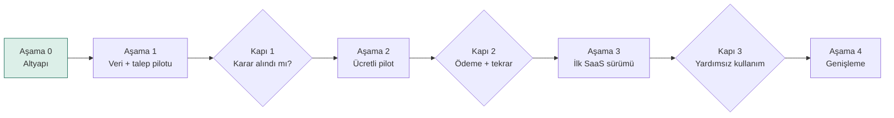
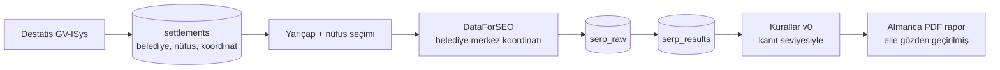

# Ortsrank – Yol Haritası

> Bölgesel hizmet veren işletmelerin Google'da hangi belediyelerde rekabetin gerisinde kaldığını ve önce nerede çalışması gerektiğini gösterir.
> İşleten: TechNS UG (haftungsbeschränkt), Oberursel · Adres: https://ortsrank.foundercheck.de
> Son güncelleme: 21.10.2026 (sürüm 3.1)

---

## 1. İlk hedef

İlk hedef "SaaS hazır" değildir. İlk hedef şudur:

> **Bir müşteri, rapor sayesinde somut bir karar aldı ve devamı için ödeme yaptı.**

Otomasyona, hesap sistemine ve plan yönetimine yapılacak yatırım bu kanıttan sonra gelir. Mimari SaaS'a hazır kurulur (çok kiracılı şema, çok dilli altyapı); ekranlar ve özellikler ise talep geldikçe eklenir.

## 2. Müşteri ne satın alıyor?

Müşteri sıralama verisi değil, **öncelik** satın alır:

- Hangi çevre belediyelerde görünürüm, hangilerinde görünmüyorum?
- Hangi rakip hizmet bölgemin çoğunu kaplıyor?
- Önce hangi belediye ve hangi hizmet için çalışmalıyım?
- Reklam bütçemi ve içerik çalışmamı nereye yönlendirmeliyim?

Harita, sıralama ve rakip tablosu tek başına fark yaratmaz; BrightLocal ve Local Falcon bunları zaten coğrafi nokta bazında sunuyor. Ortsrank'ın farkı, Almanya'daki belirli hizmet sektörleri için **anlaşılır ve kanıtı gösterilen çalışma öncelikleri** üretmesidir.

| Sadece veri | Ortsrank'ın hedeflediği çıktı |
| --- | --- |
| "Hanau'da 12. sıradasınız." | "Hanau'da üç ticari aramada ilk 10 dışındasınız; ilk 10'daki iki yerel rakibin Hanau hizmet sayfası var ve bu aramalarda sıralanıyor (gözlem). Önce mevcut sayfanızın Hanau'daki hizmet ihtiyacını karşılayıp karşılamadığını inceleyin." |

## 3. Açık soru: raporu kim kullanıyor, işi kim yapıyor?

Bu soru ürünün kapsamını belirler ve pilotta cevaplanmalıdır.

| İlk müşteri tipi | Üründen beklediği temel değer | Ürün kapsamına etkisi |
| --- | --- | --- |
| İşletme sahibi | Sorunu anlamak, önceliği görmek, işi birine aktarabilmek | Sade dil, az teknik detay, devredilebilir görev listesi |
| Ajans / pazarlamacı | Analiz süresini azaltmak, müşteriye gerekçeli öneri sunmak, değişimi takip etmek | Detaylı veri, dışa aktarma, çoklu müşteri, white-label |
| TechNS'nin kendi ekibi | Danışmanlık ve uygulama hizmetini daha hızlı hazırlamak | Rapor + uygulama paketi; yazılım değil hizmet satışı |

**Çalışma hipotezi:** İlk pilot, tek bir sektörde, **işletme sahibi ile onun pazarlama işini yapan kişinin birlikte incelediği** raporlarla yapılır. Böylece "rapor anlaşılır mı?" ve "öneri uygulanabilir mi?" soruları aynı anda test edilir.

## 4. Değişmez ilkeler

| İlke | Anlamı |
| --- | --- |
| Gerçek veri | Ölçüm birimi, Destatis GV-ISys'teki **siyasi olarak bağımsız belediyelerdir** (Gemeinden, AGS anahtarı). Köy ve mahalleler ayrı birim değildir. Taranamayan belediye "taranamadı" olarak gösterilir, başka bir yerle doldurulmaz. |
| Temsilî ölçüm noktası | İlk sürümde her belediye **tek bir merkez koordinatından** ölçülür. Rapor bunun temsilî bir nokta olduğunu açıkça söyler. Büyük şehirlerde çok noktalı ölçüm daha sonra gelir. |
| İzlenebilirlik | Rapordaki her sayı ham sağlayıcı yanıtına, tarama zamanına, koordinata ve cihaza bağlıdır (`serp_raw`). |
| Kanıt seviyesi | Her bulgu *gözlem*, *çıkarım* veya *hipotez* olarak işaretlenir (bölüm 5). LLM sayı üretmez; yalnızca işaretlenmiş bulguları metne çevirir. |
| Doğruluk vaadi yok | Doğrulanmamış bir sapma sınırı ("±2 sıra" gibi) ürün vaadi olarak kullanılmaz. Ölçüm sınırları raporda açıkça yazılır. |
| Nedensellik iddiası yok | "Sayfa yayınlandı → sıra yükseldi" etki kanıtı değildir. Ürün yalnızca yapılan işlemi ve sonrasındaki değişimi birlikte gösterir. |
| Müşteri ayrımı | Her müşteri verisi `organization_id` taşır. İlk dış kullanıcı erişiminden önce, zorunlu kiracı filtreli sorgu katmanı ve izolasyon testi hazırdır. Postgres RLS, ilk SaaS sürümünde ek savunma katmanı olarak eklenir. |
| Çok dillilik | Altyapı DE/EN/TR. Pilot arayüzü ve raporu Almanca. Arama dili her zaman Almanca. |

## 5. Kanıt seviyeleri

| Seviye | Tanım | Örnek | Raporda nasıl görünür |
| --- | --- | --- | --- |
| Gözlem | Bir veri kaynağında (SERP, sayfa taraması, GBP) doğrudan doğrulanmış olgu. Kaynak ve kapsam (tarih, nokta, cihaz, örneklem) belirtilir. Hangi kaynaktan geldiği seviyeyi değiştirmez. | "Rakibin Hanau hizmet sayfası var ve incelenen sorguda sıralanıyor." · "20.10.2026'da Hanau merkez noktasından, mobil, 3 örneklemede bu keyword için reklam görülmedi." | Doğrudan ifade + kaynak bağlantısı |
| Çıkarım | Gözlemlerin değerlendirilmesi; bir yorum içerir. Dayandığı gözlemler gösterilir. | "Sayfa içeriği, bu sorgunun hizmet ve konum niyetiyle uyumlu görünüyor." | İfade + dayandığı gözlemler |
| Hipotez | Henüz sınanmamış bir neden veya etki varsayımı. | "Benzer ihtiyacı karşılayan bir sayfa hazırlamak görünürlüğümüzü artırabilir." | "Doğrulanmalı" etiketiyle |

"Sizde yok" gibi bir ifade, ancak müşterinin kendi sitesi de aynı yöntemle kontrol edildiyse gözlemdir.

**Veriden çıkarılabilecek sonuçların sınırı**

| Toplanan veri | Destekleyebileceği sonuç | Tek başına desteklemediği sonuç |
| --- | --- | --- |
| Üç taramada reklam görülmemesi | Bu örneklerde reklam gözlenmedi | Bölgede reklam rekabeti yok |
| Rakibin ilk üçte olması | Rakip bu sorguda görünür | Rakibin SEO'su kolayca geçilebilir |
| Şehir sayfasının sonuçlarda görünmesi | Sayfa ilgili sorguda sıralanıyor | Başarının nedeni şehir sayfası |
| İşletmenin ilk 20'de bulunmaması | Taranan ilk 20 sonuçta bulunamadı | Google'da hiç görünmüyor |

**Aksiyon türleri**

| Tür | Dayandığı bulgu | Örnek |
| --- | --- | --- |
| İnceleme | Gözlem | "Önce mevcut sayfanızın Hanau'daki hizmet ihtiyacını karşılayıp karşılamadığını inceleyin." |
| İyileştirme | Gözlem + çıkarım, inceleme sonucuyla birlikte | "Ayrı ve yararlı içerik ihtiyacı doğrulandıysa mevcut sayfayı geliştirin veya yeni sayfa planlayın." |
| Doğrulama çalışması | Hipotez | "Küçük bütçeli test kampanyasıyla bu keyword'deki reklam maliyetini ölçün; sonucu kaydedin." |

Bir rakipte bir sayfanın bulunması, tek başına yeni sayfa açmayı gerekçelendirmez. Öneriler önce incelemeyle başlar; iyileştirme, ihtiyaç doğrulandıktan sonra gelir.

Hipotezi sınamak da değerli bir aksiyondur; ancak doğrulanmış bulguya dayalı iyileştirmeyle karıştırılmaz.

## 6. Ölçüm ölçütleri

İki ayrı şey ölçülür ve ayrı kabul ölçütleriyle değerlendirilir.

| Alan | Ne ölçülür | Kabul ölçütü (ilk sürüm) |
| --- | --- | --- |
| Sistem doğruluğu | Kayıt bütünlüğü | Görevlerin %100'ü başarı, hata veya iptal durumuyla kayıtlı |
| | Geçerli sonuç oranı | Tanımlanan tekrar denemelerinden sonra görevlerin en az %98'i kullanılabilir sonuç üretmiş |
| | Gönderilen parametre = kaydedilen parametre (koordinat, keyword, cihaz, dil) | %100, otomatik testle |
| | Ayrıştırma doğruluğu: ham yanıt ↔ ayrıştırılmış sonuç | 50 rastgele yanıtta elle kontrol, hata yok |
| Sonuç değişkenliği | Aynı sorgu, aynı nokta, farklı zamanlarda (ör. 3 gün) | İlk 10 örtüşmesi ve sıra farkı raporlanır; eşik değil, ölçülen değer olarak |
| | Reklam görülme sıklığı | Örneklem sayısıyla birlikte yüzde olarak verilir |

Değişkenlik ölçümünün sonucu, rapordaki ölçüm sınırı metnine olduğu gibi yazılır. Ürün vaadine dönüştürülmez.

**Dönem karşılaştırma şartları**

Dönem karşılaştırmaları aynı keyword, koordinat, cihaz, dil ve tarama derinliği üzerinden yapılır. Örnekleme saatleri mümkün olduğunca eşleştirilir. Ayar değişiklikleri işaretlenir; başarısız ölçümler sıralama kaybı sayılmaz.

## 7. Aşamalar

| Aşama | Kapsam | Geçiş ölçütü | Tahmini süre |
| --- | --- | --- | --- |
| 0. Altyapı | Domain, Vercel, repo, iskelet, şema | – | Tamamlanıyor |
| 1. Veri + talep pilotu | Script ile tarama; 1 sektör; 20–30 belediye, 3–5 keyword; 3–5 işletmeye Almanca rapor | Ölçüm ölçütleri karşılandı; pilot kayıtlarında en az 2 işletme rapor nedeniyle önceliğini değiştirdi | Teknik: 2–3 hafta · Müşteri bulma ve görüşmeler: 3–4 hafta (paralel) |
| 2. Ücretli pilot | Salt-okunur web raporu; kanıt seviyeli öneriler; ikinci tarama ve karşılaştırma | Gerçek ödeme alındı; en az 2 müşteri **ücretli** ikinci ölçüm aldı | 4–6 hafta |
| 3. İlk SaaS sürümü | Hesap, organizasyon, ödeme, kota, planlı yeniden tarama, tam hukuk metinleri | Müşteri temel akışı yardımsız tamamlıyor; ilk abonelik yenilemesi | 6–8 hafta |
| 4. Genişleme | Ajans özellikleri, white-label, ek sektörler, çok noktalı ölçüm, API, AT/CH | Mevcut müşterilerden doğrulanmış talep | sürekli |

Süreler akşam/hafta sonu temposuna göredir. Veri üretimi ile müşteri bulma, görüşme ve geri bildirim ayrı planlanır; ikincisi genellikle daha uzun sürer.

---

### Aşama 0 – Altyapı

- [x] Subdomain `ortsrank.foundercheck.de` (KAS DNS'te CNAME → `cname.vercel-dns.com`)
- [x] Vercel projesi `ortsrank` (Next.js, bölge `fra1`)
- [x] GitHub reposu `technsug-ops/-ortsrank`
- [x] İskelet: Next.js 16, React 19, Tailwind v4, TypeScript; çok dilli yönlendirme (`/de`, `/en`, `/tr`)
- [x] Çok kiracılı şema; kimlik tabloları Better Auth yapısında; `serp_raw` ve `scan_mode`
- [x] Fontlar self-host (Google Fonts'a istek yok)
- [ ] Vercel ↔ GitHub bağlantısı ve ilk production deploy
- [ ] Neon Postgres (Frankfurt), migration uygulaması
- [ ] Repo adını `ortsrank` olarak düzeltmek (isteğe bağlı)

---

### Aşama 1 – Veri + talep pilotu

**Hedef:** Gerçek verilerle, yarı manuel olarak 3–5 işletmeye rapor hazırlamak. Bu hem ölçümü hem müşterinin ilgisini sınar. Web arayüzü yok; tarama ve rapor script ile üretilir.

**Veri**

- [ ] Destatis GV-ISys import scripti: AGS, belediye adı, Bundesland, Kreis, nüfus, nüfus tarihi, koordinat
- [ ] `location_coordinate` testi: 10 belediyede koordinat sorgusu ile şehir kodu sorgusunun karşılaştırılması
  - [ ] Not: DataForSEO'daki bu yarıçap, ölçüm noktasının hassasiyetidir. Hizmet alanı yarıçapıyla (km) ilgisi yoktur; kodda ayrı adlandırılır.
- [ ] Koordinatla sorgulanamayan belediye için yedek yöntem veya `scan_mode = none`
- [ ] Tarama scripti: proje tanımı (domain, merkez, yarıçap, nüfus eşiği, keywordler) → `serp_raw` + `serp_results`
- [ ] Reklam örneklemesi: ana keyword için 3 tekrar, farklı saatlerde
- [ ] Sayfa taraması (sınırlı): ilk 10'daki yerel rakiplerin ve **müşterinin kendi sitesinin** ilgili sayfaları; "var/yok" ancak her iki taraf aynı yöntemle kontrol edildiyse gözlemdir
- [ ] Kurallar v0 (5 kural), her bulgu kanıt seviyesiyle
- [ ] Ölçüm ölçütleri (bölüm 6) için otomatik testler ve değişkenlik ölçümü
- [ ] Rapor şablonu (Almanca PDF): durum, rakipler, kanıt seviyeli öneriler, ölçüm sınırları bölümü
- [ ] Gerçek maliyet kaydı: SERP, tekrar denemeler, kontrol sorguları, sayfa taraması, LLM, depolama

**Talep**

- [ ] Sektör seçimi: Terrassenüberdachung (alternatif: Arbeitsbühnen Vermietung)
- [ ] 3–5 pilot işletme; tercihen her birinde işletme sahibi + pazarlamacısı birlikte
- [ ] Pilot anlaşması (kısa): ücretsiz/ücretli, veri kullanımı, gizlilik (bkz. Aşama 2 hukuk)
- [ ] Rapor teslimi ve açıklama görüşmesi

**Her pilot için kayıt (zorunlu)**

| # | Soru | Kayıt biçimi |
| --- | --- | --- |
| 1 | Müşteri rapordan hangi yeni bilgiyi öğrendi? | Müşterinin kendi cümlesiyle |
| 2 | Bu bilgi nedeniyle hangi önceliğini değiştirdi? | Somut karar veya "değişmedi" |
| 3 | Yapılacak işi kim üstlendi? | İşletme sahibi / mevcut ajans / TechNS / kimse |
| 4 | İkinci ölçüm için ödeme yaptı mı? | Ücretsiz tekrar istedi / ücretli ikinci ölçüm aldı / hayır |
| 5 | Raporu hazırlamak ve açıklamak toplam kaç saat sürdü? | Saat; hazırlık ve açıklama ayrı |

5. madde fiyatlandırmayı belirler: API maliyeti düşük olsa bile her müşteriye iki saat açıklama gerekiyorsa, ürün ve fiyat modeli buna göre kurulur.

**Kapı 1:** Ölçüm ölçütleri karşılandı ve pilot kayıtlarında en az 2 işletme rapor nedeniyle önceliğini değiştirdi (madde 2).

---

### Aşama 2 – Ücretli pilot

**Hedef:** Gerçek ödeme ve tekrar kullanım kanıtı.

**İlk dış erişimden önce zorunlu**

- [ ] Erişim kontrolü: müşteri yalnızca kendi raporunu görür (imzalı, süreli link veya basit giriş)
- [ ] Zorunlu kiracı filtreli sorgu katmanı + izolasyon testi
- [ ] Pilot sözleşmesi: kapsam, fiyat, süre, veri kullanımı, sorumluluk sınırı
- [ ] Datenschutzerklärung (pilot sürümü): alt işleyenler (Vercel, Neon, DataForSEO, Anthropic), AB dışı aktarım dayanağı (DPF veya SCC)
- [ ] AVV (müşteri adına veri işleniyorsa, ör. ajans müşterileri)
- [ ] Faturalama: E-Rechnung uyumlu fatura (lexoffice veya sevDesk); bu aşamada Stripe şart değil
- [ ] Impressum

**Ürün**

- [ ] Salt-okunur web raporu (Almanca): harita, belediye tablosu, rakip özeti
- [ ] Belediye detayı ve rakip özeti; her öneride kanıt seviyesi ve kaynak
- [ ] Planlı ikinci tarama ve önceki ölçümle karşılaştırma, dönem karşılaştırma şartlarına göre (bölüm 6)
- [ ] Değişim gösterimi: "işlem + sonrasındaki değişim", nedensellik iddiası olmadan
- [ ] Fiyat testi: tek rapor ve ikinci ölçüm için en az iki fiyat noktası

**Ayrı kaydedilecek sinyaller**

| Sinyal | Gücü |
| --- | --- |
| Ücretsiz tekrar isteği | Zayıf: ilgi var |
| Ücretli ikinci ölçüm | Orta: değer görüyor |
| Abonelik yenilemesi | Güçlü: düzenli kullanım |

**Kapı 2:** Gerçek ödeme alındı ve en az 2 müşteri **ücretli** ikinci ölçüm aldı.

---

### Aşama 3 – İlk SaaS sürümü

**Hedef:** Müşteri temel akışı yardımsız tamamlıyor.

- [ ] Better Auth: e-posta doğrulamalı giriş, organizasyon, davet; roller pilot bulgularına göre (başlangıçta owner + member)
- [ ] Postgres RLS (ek savunma katmanı)
- [ ] Proje oluşturma akışı: domain → sektör → merkez → yarıçap → nüfus → keywordler
- [ ] Planlı yeniden tarama (aylık) ve trend görünümü
- [ ] Planlar ve kota: plan sayısı ve sınırları Aşama 2 fiyat testine göre; maliyet tavanı
- [ ] Stripe Billing, Customer Portal, webhook ile plan senkronu
- [ ] Tam hukuk metinleri: AGB, Widerrufsbelehrung (B2C ihtimali), veri saklama politikası (ham SERP 12 ay)
- [ ] Ücretsiz deneme varsa kötüye kullanım koruması: e-posta doğrulaması, hız sınırı, günlük bütçe tavanı, bot koruması
- [ ] E-postalar (Almanca; EN/TR talep varsa): rapor hazır, değişim özeti, kota uyarısı
- [ ] Gözlem: Sentry, çerezsiz analitik (Plausible), tarama hata oranı alarmı
- [ ] Hesap silme ve veri dışa aktarma (DSGVO Art. 17 ve 20)

**Kapı 3:** Müşteriler temel akışı yardımsız tamamlıyor ve ilk abonelik yenilemesi gerçekleşti.

---

### Aşama 4 – Genişleme

Yalnızca mevcut müşterilerden doğrulanmış talep varsa:

- [ ] Ajans çalışma alanları, çoklu müşteri, white-label PDF
- [ ] Çok noktalı ölçüm (büyük şehirler için belediye içinde birden fazla nokta)
- [ ] Ek sektör keyword setleri
- [ ] Arayüz ve rapor için EN/TR
- [ ] REST API
- [ ] Avusturya ve İsviçre (Statistik Austria, BFS)
- [ ] AI arama görünürlüğü – ayrı modül olarak değerlendirme
- [ ] Sektör × belediye veri sayfaları – yalnızca kendine özgü gerçek veri taşıyorsa ve sınırlı sayıda

---

## 8. Tüm aşamalar boyunca

| Konu | Uygulama |
| --- | --- |
| Maliyet | Her tarama ve rapor için SERP, tekrar denemeler, kontrol sorguları, sayfa taraması, LLM, depolama ve **açıklama süresi** kaydedilir |
| Test | Vitest (kurallar, hesaplar, izolasyon), ölçüm ölçütü testleri; Playwright e2e Aşama 3'ten itibaren |
| Güvenlik | Gizli anahtarlar Vercel env'de; hız sınırı; bağımlılık taraması |
| Yedek | Neon point-in-time recovery; migration'lar repoda |
| Sahiplik | Kod, marka ve domain TechNS UG adına; ortak girerse IP devri yazılı |

## 9. Teknik yığın

| Katman | Seçim | Ne zaman |
| --- | --- | --- |
| Uygulama | Next.js 16, React 19, TypeScript | Aşama 0 |
| Arayüz | Tailwind CSS v4, MapLibre GL | Aşama 2 |
| i18n | `src/app/[lang]` + `proxy.ts` + JSON sözlükler | Aşama 0 |
| Veritabanı | Neon Postgres (Frankfurt), Drizzle ORM | Aşama 1 |
| SERP verisi | DataForSEO, belediye merkez koordinatıyla | Aşama 1 |
| Analiz metni | Claude API, structured output, yalnızca işaretli bulgulardan | Aşama 1 |
| PDF | Playwright | Aşama 1 |
| Kuyruk | Script (Aşama 1), Inngest (Aşama 3) | Aşama 3 |
| Kimlik | Better Auth | Aşama 3 |
| Ödeme | Fatura programı (Aşama 2), Stripe Billing (Aşama 3) | Aşama 2–3 |
| E-posta | Resend + React Email | Aşama 3 |
| Gözlem | Sentry, Plausible | Aşama 3 |

## 10. Açık kararlar

| Karar | Ne zaman gerekli |
| --- | --- |
| Pilot sektörü ve ilk 3–5 işletme | Aşama 1 başı |
| İlk müşteri tipi (sahip / ajans / TechNS hizmeti) | Aşama 1 sonu, pilot kayıtlarına göre |
| DataForSEO hesabı ve aylık bütçe limiti | Aşama 1 başı |
| Pilot fiyatı (tek rapor, ikinci ölçüm) | Aşama 2 başı |
| Plan yapısı ve abonelik fiyatı | Aşama 3 başı, fiyat testine göre |
| Ortsrank marka tescili (DPMA) | Aşama 3 öncesi |
| Ayrı domain (ortsrank.de) | Aşama 4 |

## 11. Değişiklik geçmişi

| Tarih | Sürüm | Değişiklik |
| --- | --- | --- |
| 20.10.2026 | 1 | İlk sürüm (9 teknik faz) |
| 20.10.2026 | 2 | Bağımlılıklar düzeltildi; koordinatla sorgu; `serp_raw`; Better Auth hizası; SCC/DPF; kötüye kullanım koruması |
| 21.10.2026 | 3.1 | Başarı ölçütü ikiye ayrıldı (kayıt bütünlüğü, geçerli sonuç oranı); kanıt seviyesi tanımları düzeltildi (kaynak türü seviyeyi belirlemez); "rakipte var, sizde yok → sayfa açın" yerine önce inceleme; müşterinin kendi sitesi de kontrol edilir; dönem karşılaştırma şartları eklendi |
| 20.10.2026 | 3 | Dış değerlendirmeye göre yeniden yapılandırıldı: ilk hedef "ödeme + somut karar"; 4 aşama; veri ve talep pilotu birleşti; kanıt seviyeleri ve aksiyon türleri; ölçüm ölçütleri (sistem doğruluğu ≠ değişkenlik); "±2 sıra" vaadi kaldırıldı; "her yerleşim" yerine "belediyeler" ve temsilî ölçüm noktası; tekrar ölçüm ilk ücretli sürüme alındı; erişim kontrolü ve pilot hukuku ilk dış erişimden önceye bağlandı; pilot kayıtları ve açıklama süresi; sinyaller ayrı kaydediliyor |

## İlgili belgeler

- Proje dokümanı (senaryolar, rakip analizleri): https://claude.ai/code/artifact/f682b20a-5ad9-4b55-9f46-ec5a13133c32
- Veri modeli: `src/db/schema.ts`
- Kurulum: `README.md`
